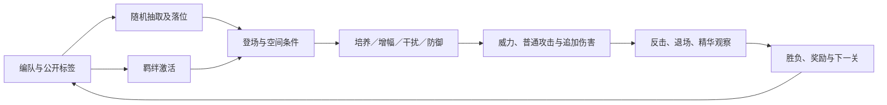

# 星穹转轮 · 机制百科

**当前规则：v0.7.0** · 2026-10-21 · 基线 [e5557f8](https://github.com/jjhe2020/starrail-landlord/tree/e5557f8d6b3ee0a0c308c5a3ca0481d3701db229) · **315 个正文与附录页面**

五列转轮构筑：招募角色、随机落位、利用公开标签与空间配合，在有限转动次数内清除十二层敌阵，之后可继续无尽。本 Wiki 记录本版**实际已实现**的规则、公式、内容参数和边界，沿关键词互相引用；本作技能为改编设计。

> [!TIP]
> 第一次阅读：[单局流程](Run-Flow) → [棋盘与目标](Board-and-Targeting) → [战斗公式](Combat) → [角色图鉴](Cards)。
> 查某个词：[术语索引](Glossary)；查某个角色、奇物或条款：[全部页面](All-Pages)。

## 内容数据库

| [角色](Cards) | [奇物](Relics) | [精华](Essences) | [羁绊](Synergies) | [敌方条款](Enemy-Effects) | [剧情委派](Assignments) |
| :---: | :---: | :---: | :---: | :---: | :---: |
| **90** 个条目 | **64** 件 | **32** 种 | **21** 种 | **32** 条 | **10** 组 |
| 命途 · 属性 · 阵营 · 职能 | 取得 · 持有 · 周期 | 指标 · 阈值 · 解锁 | 激活 · 分档 · 登场 | 资格 · 作用 · 清除 | 主持 · 受体 · 见习 |

每项均有独立页面、精确参数、实际生效解释、关联内容和固定源码出处。角色总览提供公开标签分类；相关角色互链只表示候选身份，最终仍需满足位置及实例条件。

## 游戏机制

| 基础与构筑 | 数值与结算 | 系统与复原 |
| --- | --- | --- |
| [局内流程与胜负](Run-Flow) | [威力、伤害与防御公式](Combat) | [AI 推荐、代打与训练](AI) |
| [招募与稀有度权重](Draft-and-Rarity) | [完整结算时序与效果解释器](Effects-and-Timing) | [操作、图鉴与效果查询](Interface) |
| [信用点、重掷、移除和补给](Economy) | [成长、职能培养与升星](Growth-and-Stars) | [存档、迁移与离线](Saves-and-Offline) |
| [棋盘几何与目标选取](Board-and-Targeting) | [难度、敌阵与首领分期](Difficulty) | [随机与精确复原](Reproduction) |

[进入完整机制百科](Mechanics) · [术语对照表](Glossary) · [完整数据快照](Data-Content) · [冻结算法清单](Source-Manifest)

## 规则之间如何衔接

## 常见查阅入口

- [相邻、同行同列与空位](Board-and-Targeting)：相邻包含对角；不跨行绕边；扩散根据实际主目标的相邻敌列结算。
- [支援的培养](Growth-and-Stars)：支援不执行普攻；培养只放大明确标记的职能效果；培养主持不接受培养。
- [乘区与上限](Combat)：现代角色增幅池最高×2.2；易伤增量最高75%；其余倍率各按来源处理。
- [身份与临时状态](Assignments)：正式、temporary 与 commission 的排除条件不同，逐机制说明。
- [抽卡概率](Draft-and-Rarity)与[AI 选择概率](AI)：前者逐条内容加权，后者候选加跳过共同 softmax，均不能当通关率。
- [第十二关和无尽](Run-Flow)：第十二关先发赏金后胜利，不发本层奖励队列；继续后直接第十三关。

## 版本、依据与取得游戏

本次 Wiki 与 [v0.7.0 Release](https://github.com/jjhe2020/starrail-landlord/releases/tag/v0.7.0) 对齐；仓库及 Wiki 保持私有，需要仓库访问权限。游戏与报告均从该 Release 取得。

规则依据优先级：冻结实现与内容定义 → 对应行为测试 → 本 Wiki 公式与条目。遇到表述省略，可沿页面出处查到准确语句；[39 份冻结源码/配置](Source-Manifest)提供完整非图像实现后备，并有逐文件 SHA-256，便于几乎完全复原。正文没有把历史研究、内部测试套路或未来路线图写成当前规则。

平衡结论与机制规格分别阅读：[本版测试报告](https://github.com/jjhe2020/starrail-landlord/blob/e5557f8d6b3ee0a0c308c5a3ca0481d3701db229/docs/V070-BALANCE.md)。本版属于可玩测试版，功能检查通过不等于已证明全面平衡。角色头像归属 HoYoverse，来源见[素材记录](https://github.com/jjhe2020/starrail-landlord/blob/e5557f8d6b3ee0a0c308c5a3ca0481d3701db229/docs/ASSETS.md)。
