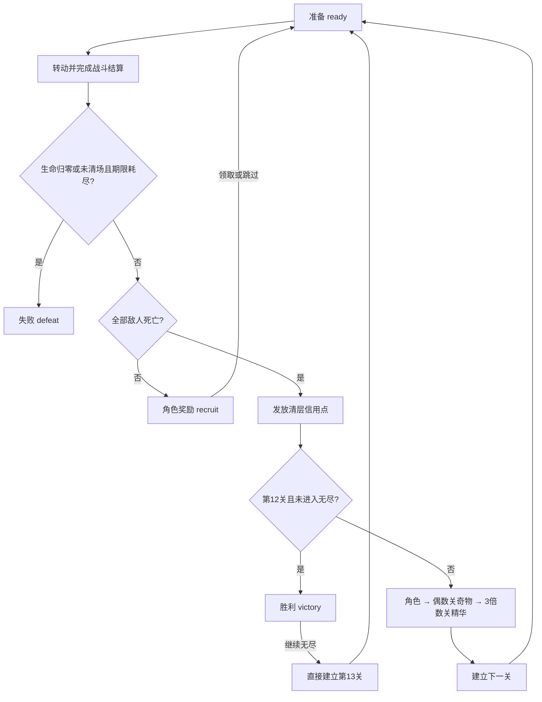

# 单局流程与状态机

> 规则版本：v0.7.0。关联：[首页](Home) · [难度与敌阵](Difficulty) · [战斗](Combat) · [奖励](Draft-and-Rarity)。

星穹转轮是一款以随机落位、公开标签和永久编队为核心的回合构筑游戏。基础目标是在每关期限内消灭全部敌人，并让列车生命保持大于零。普通旅程共 **12 关**；第 12 关清场进入胜利，之后可主动进入无尽。

## 初始状态

| 项目 | 数值或规则 |
| --- | --- |
| 初始层/层内回合 | 1 / 0；第一次转动后回合成为 1 |
| 默认难度 | D10，可直接选择 D1–D20；无需解锁 |
| 生命/生命上限/护盾 | 100 / 100 / 0 |
| 信用点/免费重掷/移除次数 | 0 / 2 / 2 |
| 初始角色 | [三月七](Card-1001)、[丹恒](Card-1002)、[艾丝妲](Card-1009)、[黑塔](Card-1013)、[娜塔莎](Card-1105)，均一星、成长 0、登场计数 0 |
| 棋盘 | 5 列 × 4 行，共 20 格；初始展示位 10–14，每次转动重新抽取和落位 |
| 奇物、精华、委派统计 | 空、空、全部为零 |
| 每关补给次数 | 2；换关重置，不是每轮 2 次 |
| 编队硬上限 | 200；所有临时、见习和正式实例均占编队空间 |

## 阶段与合法动作

| phase | 含义 | 合法的玩家动作 |
| --- | --- | --- |
| `ready` | 准备转动 | 转动、移除、购买补给 |
| `recruit` | 角色三选一 | 领取、跳过、重掷、移除 |
| `item` | 奇物三选一 | 领取、跳过、重掷、移除 |
| `essence` | 精华三选一 | 领取、跳过、重掷、移除 |
| `victory` | 普通旅程获胜 | 继续无尽或开启新局 |
| `defeat` | 旅程失败 | 开启新局 |

所有引擎动作先检查阶段、资源、候选序号等条件。无效动作返回原状态，不推进随机数。有效动作复制状态后修改副本；[AI](AI)试算也遵守这一约定。

## 回合预算与换关

基础转动次数为 `5 + floor((min(关数,12)-1)/4)`：1–4 关 5 次、5–8 关 6 次、9 关起 7 次。[公司咕咕钟](Relic-seal_stamp)额外增加 1 次；`extraSpin` 效果同时增加剩余转动次数与本关总期限。层内回合计数每关重置，角色登场计数和成长持续整局。

建立新关时按顺序：回合归零、重建期限和敌人、选本关基础敌技、清除旧条款、设置首领阶段、重置补给次数、抽取本关条款与污染、执行 `floor` 效果、生成下轮敌人意图。非第一关再加 **1 次免费重掷**，进入偶数关再加 **1 次移除**，随后执行历史奇物/精华的换关护盾。

生命、护盾、信用点、编队、奇物、精华、待用超频都没有普通换关清空规则；护盾始终受两倍生命上限限制。上一轮棋盘可作为画面快照保留，到下次转动才重新抽牌。

## 奖励队列

未清场且未失败的每次转动后只发一次角色奖励。清场后仍只发一次角色奖励，再按完成的关数追加：偶数关发奇物；3 的倍数关发精华。队列顺序固定 **角色 → 奇物 → 精华**，领取或跳过当前项后才展示下一项。

例如第 6 关清场：立即获得 `8 + 6×3 = 26` 信用点，依次选角色、奇物、精华，全部处理完后进入第 7 关。跳过不自动补偿资源；只有某类独占奖励已全部拥有、无法生成候选时，队列才自动补 **10 信用点**并继续。

**第 12 关例外**：先获得清层赏金与[天使型谢债发行机](Relic-angel_debt)奖励，然后直接胜利，清空奖励队列，不再发这一关的角色、奇物或精华。点击继续无尽直接建立第 13 关，不补发第 12 关奖励。

## 胜负顺序与无尽

每轮在攻击、反击、清理退场、精华观察等步骤后判定。生命为 0 即失败；未清场且剩余次数为 0 也失败；清场且生命大于 0 则过关，因此**最后一次转动清场有效**。污染可在角色治疗前直接致死；致死反击之后精华不能复活列车。详见[完整时序](Effects-and-Timing)。

进入无尽后 `endless=true`；敌人生命继续随关数增长，基础转动次数停在 7，仍可被奇物及效果延长。偶数关奇物、3 倍数关精华、每 3 关首领及阶段条款继续；不会再触发普通第 12 关的胜利终止。

## 本页复原依据

[初始状态与资源函数](https://github.com/jjhe2020/starrail-landlord/blob/e5557f8d6b3ee0a0c308c5a3ca0481d3701db229/src/engine.js#L347)、[换关](https://github.com/jjhe2020/starrail-landlord/blob/e5557f8d6b3ee0a0c308c5a3ca0481d3701db229/src/engine.js#L234)、[奖励队列和清层](https://github.com/jjhe2020/starrail-landlord/blob/e5557f8d6b3ee0a0c308c5a3ca0481d3701db229/src/engine.js#L513)、[胜负判定](https://github.com/jjhe2020/starrail-landlord/blob/e5557f8d6b3ee0a0c308c5a3ca0481d3701db229/src/engine.js#L900)、[无尽](https://github.com/jjhe2020/starrail-landlord/blob/e5557f8d6b3ee0a0c308c5a3ca0481d3701db229/src/engine.js#L1016)。
